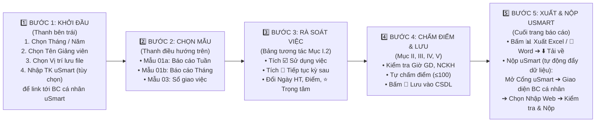
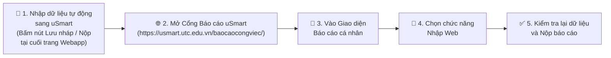
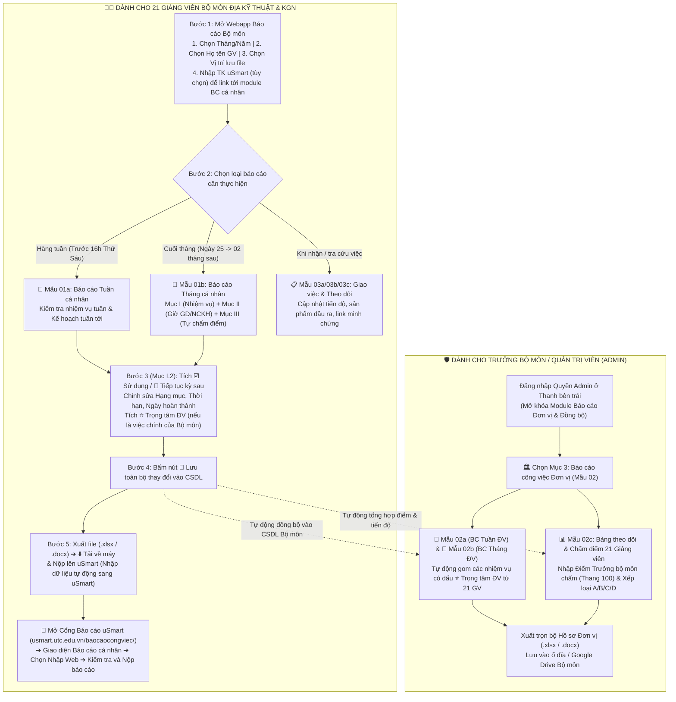
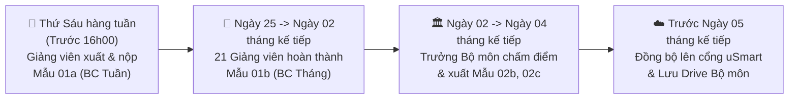

# 🗺️ ROADMAP HƯỚNG DẪN SỬ DỤNG HỆ THỐNG BÁO CÁO CÔNG VIỆC
**Đơn vị:** Bộ môn Địa kỹ thuật và Không gian ngầm — Khoa Công trình — Trường Đại học Giao thông vận tải (UTC)  
**Căn cứ áp dụng:** Thông báo số **940/TB-ĐHGTVT** & Nghị định số **233/2026/NĐ-CP**  
**Trưởng bộ môn:** GS.TS. Trần Thế Truyền  

---

## 1. SƠ ĐỒ TỔNG QUAN 5 BƯỚC DÀNH CHO GIẢNG VIÊN TRONG BỘ MÔN (THAO TÁC TRONG 2 PHÚT)

---

## 2. SƠ ĐỒ CHI TIẾT LUỒNG NỘP BÁO CÁO LÊN CỔNG USMART (BƯỚC 5)

🔗 **Link truy cập trực tiếp Cổng Báo cáo uSmart:** [https://usmart.utc.edu.vn/baocaocongviec/](https://usmart.utc.edu.vn/baocaocongviec/)

---

## 3. SƠ ĐỒ PHỐI HỢP GIỮA 21 GIẢNG VIÊN & TRƯỞNG BỘ MÔN (ADMIN)

---

## 4. HƯỚNG DẪN THAO TÁC TỪNG BƯỚC CHO THÀNH VIÊN BỘ MÔN

| Bước | Vị trí trên màn hình | Thao tác cụ thể của Giảng viên | Kết quả đạt được |
| :--- | :--- | :--- | :--- |
| **Bước 1** | **Thanh bên trái (Sidebar)** | 1. Chọn **Tháng / Năm** báo cáo. 2. Chọn đúng **Mã cán bộ – Họ và tên** của mình. 3. Chọn **Vị trí lưu file** (Thư mục dự án, Downloads, Desktop hoặc tự nhập đường dẫn). 4. **Nhập tài khoản uSmart (tùy chọn)** để liên kết trực tiếp đến module Báo cáo công việc cá nhân trên [Cổng uSmart](https://usmart.utc.edu.vn/baocaocongviec/). | Hệ thống tự động nạp toàn bộ dữ liệu giảng dạy (TKB), đề tài NCKH, công việc của giảng viên và kết nối sẵn phiên làm việc uSmart. |
| **Bước 2** | **Thanh chọn Kiểu báo cáo** | • Chọn **📄 1. Báo cáo công việc cá nhân**. • Chọn tiếp **📅 Mẫu 01a — Báo cáo Tuần** hoặc **📆 Mẫu 01b — Báo cáo Tháng**. | Hiển thị đúng mẫu biểu hành chính theo Thông báo 940/TB-ĐHGTVT ngay trên màn hình. |
| **Bước 3** | **Mục I.2 — Danh sách nhiệm vụ** | • **Tái sử dụng việc cũ:** Tích vào ô *"Hiển thị thêm công việc từ báo cáo kỳ trước..."* rồi tích `☑️ Sử dụng` ở dòng muốn lấy lại. • **Chỉnh sửa trực tiếp:** Nhấp đúp vào ô để sửa Nội dung, Nguồn giao, Thời hạn, Ngày hoàn thành, Tình trạng, `% Hoàn thành`. • **Chuyển lên Đơn vị:** Tích `⭐ Trọng tâm ĐV` nếu muốn đưa công việc đó vào Báo cáo Đơn vị (Mẫu 02a/02b). | Không phải gõ lại các công việc lặp lại hàng tháng (giảng dạy, hướng dẫn ĐATN, trực PTN, NCKH). |
| **Bước 4** | **Mục II, III, IV, V & Nút Lưu** | • **Mục II (Mẫu 01b):** Kiểm tra số giờ Giảng dạy, NCKH, Nhiệm vụ khác. • **Mục III (Mẫu 01b):** Nhập **Điểm tự chấm Tiêu chí chung** ($\le 30$) và **Điểm tự chấm Kết quả nhiệm vụ** ($\le 70$). • **Mục IV & V:** Rà soát kế hoạch kỳ tới và đề xuất kiến nghị (nếu có, mặc định để trống). • Bấm nút màu xanh **💾 Lưu toàn bộ thay đổi vào CSDL**. | Dữ liệu được kiểm tra logic vật lý và lưu an toàn vào CSDL Bộ môn. |
| **Bước 5** | **Khu vực Xuất file & Nộp uSmart** | • **Xuất file về máy:** Bấm **📊 Xuất Mẫu 01 (.xlsx)** hoặc **📝 Xuất Bản cứng (.docx)** ➔ bấm **⬇️ Tải trực tiếp tệp về máy (Save As...)**. • **Nộp lên uSmart (Nhập dữ liệu tự động sang uSmart):** &nbsp;&nbsp;1. Bấm nút đẩy dữ liệu tự động lên uSmart. &nbsp;&nbsp;2. Mở [**🔗 Cổng Báo cáo uSmart**](https://usmart.utc.edu.vn/baocaocongviec/) ➔ vào **Giao diện Báo cáo cá nhân** ➔ chọn **Nhập Web** ➔ **Kiểm tra và Nộp báo cáo**. | Vừa có sẵn file Excel/Word chuẩn lưu máy, vừa hoàn tất nộp trực tuyến trên cổng uSmart của Nhà trường. |

---

## 5. LỊCH TRÌNH ĐỊNH KỲ TRONG THÁNG (TIMELINE CHUẨN TB 940/TB-ĐHGTVT)

---
📧 **Hỗ trợ kỹ thuật & Quản trị hệ thống:** **Nguyễn Hải Hà_Bộ môn Địa kỹ thuật và không gian ngầm** ([haihadkt@utc.edu.vn](mailto:haihadkt@utc.edu.vn))
